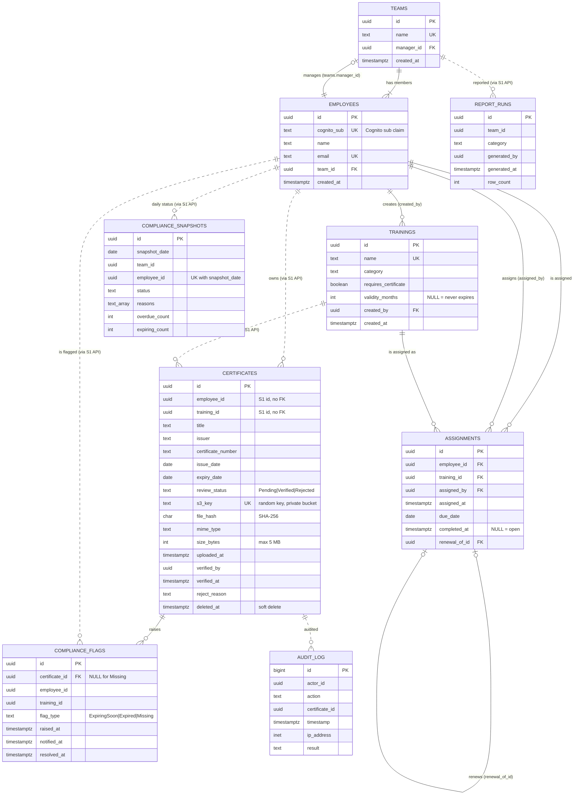

# ER diagram: Employee Training Tracker

Source of truth: `infra/db/schema.sql`. GitHub renders the Mermaid diagram below. For the report, paste it into https://mermaid.live and export a PNG.

Solid lines are **real foreign keys**. They only exist inside one service's own tables. Dotted lines are **logical links across services**: they are not foreign keys, and the owning service checks them through the other service's API.

## Which service uses which entity, and how

| Entity | Owner | Create | Read / query | Update | Delete |
|---|---|---|---|---|---|
| teams | S1 | seed | S1: `GET /api/teams`, ownership checks; S2/S3 through S1's API | none | none |
| employees | S1 | seed + Cognito provisioning | S1: `/api/employees/me`, `/api/employees/{id}`, team members | `cognito_sub` set at provisioning | none |
| trainings | S1 | `POST /api/trainings` | `GET /api/trainings?category=`, `GET /api/trainings/{id}` | `PUT /api/trainings/{id}` (creator only) | none |
| assignments | S1 | `POST /api/assignments`, renewal on complete | `/api/assignments/me`, `/api/teams/{id}/assignments?status=` | `PATCH .../complete` sets `completed_at` | none (history) |
| certificates | S2 | `POST /api/certificates` | `/me`, `?teamId=&reviewStatus=`, `/{id}` | `PUT` while Pending, `PATCH verify` | soft delete (`deleted_at`) |
| compliance_flags | S2 | daily run-check | `GET /api/compliance/teams/{id}` | resolve / `notified_at` | none |
| audit_log | S2 | every upload, update, verify, reject, download, delete | investigation | **never** (append-only) | **never** |
| compliance_snapshots | S3 | nightly run-snapshot (upsert) | `/trend` | upsert on the same day | none |
| report_runs | S3 | every report | `/api/reports/history` | none | `DELETE /api/reports/history/{id}` |

**Key constraints**
- **One open assignment:** a partial unique index on `assignments(employee_id, training_id) WHERE completed_at IS NULL`.
- **Certificate dates:** a CHECK that `issue_date <= expiry_date`.
- **One open flag:** a unique index on `compliance_flags(employee_id, training_id, flag_type) WHERE resolved_at IS NULL`.
- **One snapshot per day:** `UNIQUE (employee_id, snapshot_date)` on `compliance_snapshots`.
